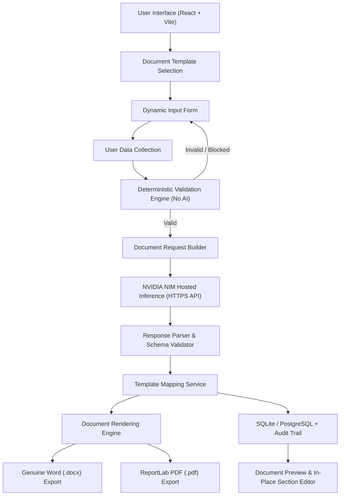

# Architecture Specification – AiDocMaker Platform

## 1. Executive Summary

**AiDocMaker** is an enterprise document automation platform engineered for controlled regulatory environments (such as medical device quality systems adhering to ISO 13485:2016).

The platform previously depended on a multi-component local model stack (local Ollama daemon, in-process weight execution, local training and embedding scripts). In this refactoring, that architecture has been replaced with a cloud-accelerated **NVIDIA NIM hosted API** infrastructure while strictly preserving:
- Deterministic rules validation before external AI invocation.
- Complete document revision immutability and audit trails.
- Independent author, reviewer, and approver quality gates.
- Genuine `.docx` and `.pdf` generation via native document generators.

---

## 2. Target System Architecture



---

## 3. Core Component Breakdown

### 3.1. Frontend Application (`apps/web`)
- **Technology:** React 19, Vite, Lucide Icons, pure modular CSS.
- **Key Modules:**
  - `DocumentWorkspace`: Central document drafting, validation feedback, and draft inspection pane.
  - `GenerationProgressModal`: Multi-stage interactive visual progress indicator showing the 6 stages of the document generation pipeline.
  - `SectionEditor`: In-place editing and single-section AI regeneration controls.
  - `TemplatesPage & CustomTemplateModal`: Library of starter and user-defined templates with dynamic field and section authoring.
  - `SettingsPage`: Diagnostics console displaying live latency benchmarks and health checks against the NVIDIA hosted API and database.

### 3.2. Backend API Service (`apps/api`)
- **Technology:** FastAPI, Python 3.13, Pydantic v2, SQLAlchemy, ChromaDB.
- **Service Modules:**
  - `NvidiaService` (`app/services/nvidia_service.py`): Enterprise client managing authentication, chat completions, connection testing, token latency tracking, bounded exponential retries, and markdown/reasoning stripping.
  - `TemplateMappingService` (`app/services/template_mapping_service.py`): Ingests validated AI responses, matches section IDs against template ordering, applies fallback placeholders for missing optional sections, and executes atomic single-section content updates.
  - `DocumentGenerator` (`app/services/document_generator.py`): Pure Python rendering service producing authentic Word (`.docx`) files with standard XML schemas (`PK\x03\x04`) and publication-grade PDFs via ReportLab (`%PDF-1.4`).
  - `ValidationService` (`app/services/validation_service.py`): Pure deterministic rules engine evaluating required fields, data formats, regex constraints, and regulatory applicability. Zero external AI dependencies.
  - `TemplateRegistry` (`app/templates/registry.py`): In-memory and runtime registry containing 10 pre-defined standard operating templates and supporting dynamically registered custom templates.

---

## 4. Document Lifecycle and State Machine

Revisions transition through an immutable state machine:

```
[ draft ]
    │
    ▼ (Save & Validate)
[ validated ]
    │
    ▼ (Generate with NVIDIA NIM)
[ generated ]
    │
    ▼ (Submit for Review)
[ in_review ]
    │
    ├── (Changes Requested) ──► [ changes_requested ] ──► (Create New Revision)
    ▼ (Review Accepted)
[ awaiting_approval ]
    │
    ├── (Rejected) ───────────► [ rejected ]
    ▼ (Approved)
[ released ] (Immutable Revision; DOCX/PDF Final Exports)
```

### Governance Rules:
1. **Validation Gate:** Generation is strictly rejected if any blocking findings exist.
2. **Segregation of Duties:** The user who authored a revision cannot act as its independent reviewer or approver.
3. **Immutability of Released Revisions:** Once a revision is marked `released`, it cannot be edited or overwritten. Modifications require issuing a subsequent revision (`Rev 2`, `Rev 3`).

---

## 5. Security & Data Protection Boundaries

- **Secret Isolation:** The `NVIDIA_API_KEY` is never transmitted to the browser or logged in plain text.
- **Private Data Storage:** Document content and evidence metadata reside exclusively in the local database and private storage directories.
- **Deterministic Embeddings:** Without requiring local Ollama daemons, the vector search engine employs a normalized token-overlap hashing algorithm guaranteeing positive cosine bounds in ChromaDB.
